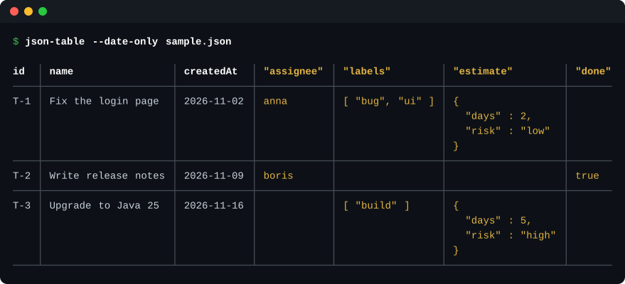

# ai-misc-graalvm

Experiments with Jackson and GraalVM native images, and a small start-up benchmark of the JVM,
a GraalVM native executable, jq, Go, Node.js and Python.

| Part | Question | Where |
| :--- | :--- | :--- |
| Jackson tests | Does ordinary reflection-based Jackson work in a native image? | [`src/`](src), [`spring-boot-binding/`](spring-boot-binding) |
| Notes | What has to be registered, and the traps | [docs/jackson-native-image.md](docs/jackson-native-image.md) |
| json-table | A small JSON-to-table tool, the same program in six technologies, and the benchmark | [json-table/README.md](json-table/README.md) |
| Results | The latest benchmark report | **[Releases, latest](https://github.com/krm-demo/ai-misc-graalvm/releases/latest)** |

## Jackson in a native image

Yes, it works, with every Jackson feature we tried: records, nested types, builders, polymorphism, `TypeReference`.
The one rule: **every class Jackson binds must be registered for reflection at build time**,
including nested types, subtypes and builder classes. A missing registration does not fail the build;
it fails when the binary runs, so the tests run as a native binary in CI.

- [`JacksonNativeImageTest`](src/test/java/org/krmdemo/graalvm/jackson/JacksonNativeImageTest.java): plain Jackson,
  registration in a [`reflect-config.json`](src/main/resources/META-INF/native-image/org.krm-demo/ai-misc-graalvm/reflect-config.json).
- [`SpringBindingNativeImageTest`](spring-boot-binding/src/test/java/org/krmdemo/graalvm/spring/SpringBindingNativeImageTest.java):
  Spring Boot AOT with `@RegisterReflectionForBinding` and `RuntimeHintsRegistrar`.

Both run the same cases on the JVM and as a native binary, and assert which cases must fail without registration.
Details, examples and a checklist: [docs/jackson-native-image.md](docs/jackson-native-image.md).

```
mvn test                                     # plain Jackson, JVM only
mvn -Pnative test                            # JVM, then native (needs GraalVM)
cd spring-boot-binding && mvn -PnativeTest test
```

## json-table and the benchmark



[`json-table`](json-table/README.md) reads a JSON array of objects and prints it as a table
(Java 21+, Jackson 3, Picocli; also built as a GraalVM native executable). The same program exists
in jq + bash, Go, Node.js and Python, and all of them print byte-for-byte the same table.

The [`json-table-bench`](.github/workflows/json-table-bench.yml) workflow times them on three platforms
and three input sizes and publishes the combined report as a **[GitHub Release](https://github.com/krm-demo/ai-misc-graalvm/releases/latest)**.
Releases are permanent; workflow runs and their summaries are deleted by GitHub after 90 days.

- **Run it:** Actions, [`json-table-bench`](https://github.com/krm-demo/ai-misc-graalvm/actions/workflows/json-table-bench.yml), *Run workflow*;
  it also runs on every push to `main` that changes code under `json-table/`.
- **Read it:** [the latest release](https://github.com/krm-demo/ai-misc-graalvm/releases/latest); the 5 newest reports are kept.
- **Understand it:** how the benchmark works and which technology suits which job: [json-table/README.md](json-table/README.md#benchmark).

## Workflows

| Workflow | Runs on | What it checks or produces |
| :--- | :--- | :--- |
| [`native-tests`](.github/workflows/native-tests.yml) | push to `main`, pull requests | the Jackson and Spring Boot cases, on the JVM and as native binaries; per-case results in the run summary |
| [`json-table`](.github/workflows/json-table.yml) | push to `main` and pull requests under `json-table/` | builds the jar and the native executable, compares their output with each other and with the jq script, runs the command-line smoke test |
| [`json-table-bench`](.github/workflows/json-table-bench.yml) | push to `main` under `json-table/`, by hand | the benchmark; publishes the report as a release |
