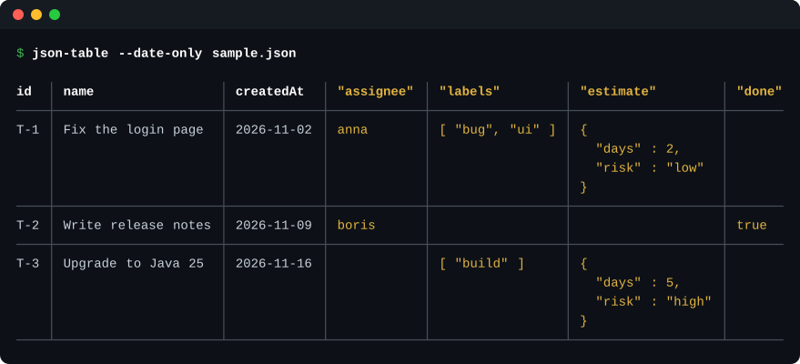

# json-table

A small command-line tool that turns a JSON array of objects into a table, written to see how fast
a Java program (Jackson 3 + Picocli) starts on an ordinary JVM, as a GraalVM native executable,
and next to the same program in jq, Go, Node.js and Python.



The input of that run is [`sample.json`](sample.json):

```json
[
  {
    "id": "T-1",
    "name": "Fix the login page",
    "createdAt": "2026-11-02T09:30:00Z",
    "assignee": "anna",
    "labels": ["bug", "ui"],
    "estimate": { "days": 2, "risk": "low" }
  },
  {
    "id": "T-2",
    "name": "Write release notes",
    "createdAt": "2026-11-09T14:05:00Z",
    "assignee": "boris",
    "done": true
  },
  {
    "id": "T-3",
    "name": "Upgrade to Java 25",
    "createdAt": "2026-11-16T08:00:00Z",
    "assignee": null,
    "labels": ["build"],
    "estimate": { "days": 5, "risk": "high" }
  }
]
```

- `id`, `name` and `createdAt` are the properties the program knows; they come first.
- Every other property gets its own column, in order of first appearance, with its name in quotes and in yellow.
- Nested objects and arrays are printed as pretty JSON inside the cell.
- A missing property and `null` both give an empty cell.

## Build and run

```
mvn package                 # target/json-table-1.0.jar, runs on any JDK 21+
mvn -Pnative package        # also target/json-table, needs GraalVM as JAVA_HOME

java -jar target/json-table-1.0.jar sample.json
target/json-table --date-only sample.json
cat sample.json | target/json-table -
```

Without arguments, or with `--help`, it prints what it expects:

```text
Usage: json-table [-hV] [--date-only] [--debug] [--timing] [--color=WHEN] FILE

Prints a JSON array of objects as a table.

Expected input
  A JSON array whose elements are objects, for example:

    [ { "id": "T-1", "name": "Fix the login page", "assignee": "anna" } ]

  id, name        text, each in its own column
  createdAt       ISO-8601 instant, in its own column
  anything else   one extra column per property; nested objects
                  and arrays are shown as pretty JSON

Parameters
      FILE           JSON file to read; use - for standard input.

Options
      --date-only    Show createdAt as a date (UTC), without the time.
      --color=WHEN   auto (default: colours only on a terminal and without
                       NO_COLOR), always or never.
      --timing       Print the start time, the end time and the duration to
                       standard error.
      --debug        On error, print the full stack trace instead of a one-line
                       message.
  -h, --help         Show this help message and exit.
  -V, --version      Print version information and exit.

Examples
  json-table sample.json
  json-table --date-only sample.json
  cat sample.json | json-table -

Exit codes
  0  success
  1  the input could not be read or is not valid
  2  wrong command-line arguments
```

## Errors

Nothing escapes as a raw stack trace. An error is one line that starts with a label, in bold red on a terminal;
`--debug` adds the stack trace.

| Label | When |
| :--- | :--- |
| `FILE NOT FOUND:` | the file does not exist |
| `ACCESS DENIED:` | the file cannot be read |
| `INVALID JSON:` | the text is not JSON; the message has the line and column |
| `INVALID DATA:` | valid JSON that does not fit, for example `createdAt` is not an instant |
| `I/O ERROR:` | any other failure while reading |
| `USAGE ERROR:` | unknown option, wrong option value or missing `FILE` (exit code 2) |
| `ERROR:` | anything else |

[`smoke-test.sh`](smoke-test.sh) checks the help, the exit codes and these messages for both builds;
the [`json-table`](../.github/workflows/json-table.yml) workflow runs it.

## The same program in other languages

Each one prints byte-for-byte the same table as the Java program run without options (no colours, no `--date-only`).

| Language | Source | Notes |
| :--- | :--- | :--- |
| jq + bash | [`json-table-jq.sh`](json-table-jq.sh) | one `jq` call; the table layout is written in the jq language |
| Go | [`alt/go/main.go`](alt/go/main.go) | standard library only; reads tokens to keep the property order |
| Node.js | [`alt/json-table.mjs`](alt/json-table.mjs) | built-ins only |
| Python | [`alt/json_table.py`](alt/json_table.py) | standard library only |

They print `createdAt` as it is written in the input, while Java parses it into an `Instant`; for inputs like the ones here the result is the same.

## Benchmark

The [`json-table-bench`](../.github/workflows/json-table-bench.yml) workflow measures the **whole process**:
starting the runtime, reading and parsing the file, building the table and writing it to a discarded output.

- **Tool:** [hyperfine](https://github.com/sharkdp/hyperfine), 2 warm-up runs, then 15 timed runs (7 for the largest input).
- **Matrix:** 3 platforms (`ubuntu-latest`, `ubuntu-24.04-arm`, `macos-latest`) x 3 input sizes (10, 1,000 and 100,000 objects; the largest file is 24 MB).
- **Candidates:** the same jar on Corretto 25, Oracle JDK 25, Zulu 25 and GraalVM 25; the GraalVM native executable; jq; Go; Node.js 24; Python 3.14.
- **Fairness:** all candidates of one job run on the same machine, and the job first checks that they all print the same table.
- **Report:** every job writes its table, the sources it used, the sample input and output, and the versions to the run summary ([`bench-summary.sh`](bench-summary.sh)).

### Results

Mean time per run, from [run №4](https://github.com/krm-demo/ai-misc-graalvm/actions/runs/44612755713) (commit `bb9d597`, 2026-11-19). Rows are sorted by the 1,000-row column.

**Linux x64** (`ubuntu-latest`, AMD EPYC 7763)

| Candidate | 10 rows | 1,000 rows | 100,000 rows |
| :--- | ---: | ---: | ---: |
| Go | 1.7 ms | 6.7 ms | 542 ms |
| Node.js 24 | 29.1 ms | 43.7 ms | 1.19 s |
| Python 3.14 | 23.5 ms | 44.2 ms | 2.84 s |
| GraalVM 25 (native) | 9.6 ms | 45.8 ms | 2.70 s |
| jq + bash | 10.3 ms | 132 ms | 12.96 s |
| Oracle JDK 25 | 503 ms | 603 ms | 2.95 s |
| GraalVM 25 (JIT) | 538 ms | 604 ms | 3.33 s |
| Corretto 25 | 504 ms | 605 ms | 2.89 s |
| Zulu 25 | 500 ms | 619 ms | 2.93 s |

**Linux ARM64** (`ubuntu-24.04-arm`, Neoverse-N2)

| Candidate | 10 rows | 1,000 rows | 100,000 rows |
| :--- | ---: | ---: | ---: |
| Go | 1.5 ms | 7.0 ms | 585 ms |
| Node.js 24 | 24.3 ms | 42.2 ms | 1.20 s |
| GraalVM 25 (native) | 8.8 ms | 43.0 ms | 2.87 s |
| Python 3.14 | 20.6 ms | 43.4 ms | 2.48 s |
| jq + bash | 7.9 ms | 136 ms | 13.29 s |
| Corretto 25 | 448 ms | 660 ms | 2.68 s |
| GraalVM 25 (JIT) | 479 ms | 670 ms | 4.12 s |
| Oracle JDK 25 | 439 ms | 670 ms | 2.64 s |
| Zulu 25 | 439 ms | 681 ms | 2.67 s |

**macOS ARM64** (`macos-latest`, Apple M1 virtual machine)

| Candidate | 10 rows | 1,000 rows | 100,000 rows |
| :--- | ---: | ---: | ---: |
| Go | 7.9 ms | 9.4 ms | 419 ms |
| GraalVM 25 (native) | 39.0 ms | 40.1 ms | 2.47 s |
| Python 3.14 | 75.2 ms | 74.0 ms | 1.94 s |
| Node.js 24 | 99.8 ms | 84.6 ms | 987 ms |
| jq + bash | 32.1 ms | 212 ms | 14.71 s |
| GraalVM 25 (JIT) | 772 ms | 522 ms | 3.07 s |
| Zulu 25 | 710 ms | 570 ms | 2.76 s |
| Corretto 25 | 806 ms | 595 ms | 2.83 s |
| Oracle JDK 25 | 744 ms | 782 ms | 2.63 s |

### What the numbers say

- **Go is the fastest** at every size and on every platform.
- **The JVMs do not differ from each other.** Corretto, Oracle JDK and Zulu are within noise; GraalVM used as a JIT is slower on the largest input.
- **Start-up is what a native image buys.** On a small input the native executable is about 50 times faster than the same code on a JVM on Linux (about 20 times on macOS) and on a par with jq.
- **On a large input the JVM catches up.** With 100,000 objects the native executable and the JVMs are close to each other, and Node.js is more than twice as fast as both.
- **jq is slow on the large input** because the table layout runs in the jq language; this says little about its JSON parser.

### How far to trust them

- Shared CI machines are noisy. The macOS runs vary the most (there several 10-row runs of the JVMs came out slower than their 1,000-row runs), so read that table as a rough order only.
- Compare numbers only inside one table column of one run: every job gets a different machine.
- The Java program has not been profiled or tuned, so its time on the largest input is that of the first working version.
- To repeat the measurement, start the workflow by hand (Actions, `json-table-bench`, "Run workflow") or push a change under `json-table/` in a pull request.

## Files

| Path | What |
| :--- | :--- |
| `src/main/java/org/example/jsontable/` | `Main` (command line, table) and `Item` (one array element) |
| `src/main/resources/META-INF/native-image/` | reflection configuration for `Item`; Picocli's is generated at build time |
| `sample.json` | the example above |
| `run-jvm.sh`, `run-native.sh` | run one build and print the elapsed time |
| `smoke-test.sh` | command-line checks |
| `json-table-jq.sh`, `alt/` | the other implementations |
| `bench-summary.sh` | the report written by each benchmark job |
| `docs/example.svg`, `docs/ansi2svg.py` | the picture above and the script that draws it from `--color=always` output |
